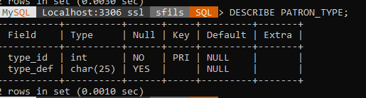
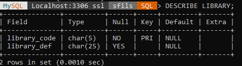
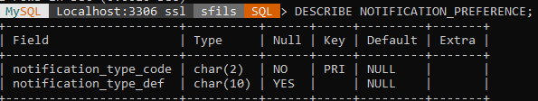
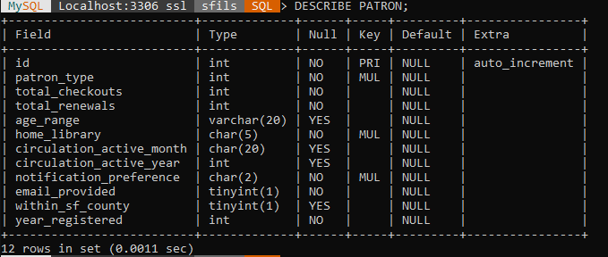

# Project Documentation

Here, we maintain the documentation of the project.

This includes how to build and run the software, along with any screenshots that can be of help.

## Initial Setup

First, we need to set up python. 
- Install python and python-pip
- Install the mysql-connector-python package

Set up your MySQL
- Create a user with admin priveleges
- insert login credentials to scripts/login.py

Create and populate database
- Run the scripts/import_data.py script to automatically create and populate database

Run app/app.py

## Schema

Patron Type table

Library table

Notification Preference table

Patron table

home_library is a foreign key from Library(library_code)
patron_type is a foreign key from Patron_Type(type_id)
notification_preference is a foreign key from NotificationPreference(notificaion_type_code)